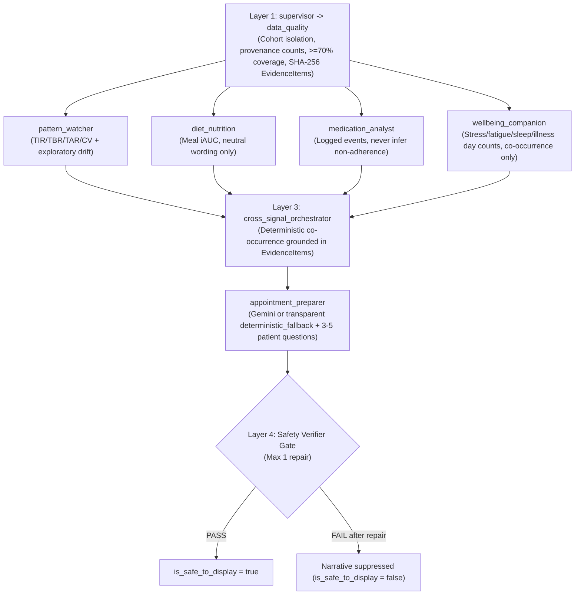

# GlyCadence Multi-Agent Architecture (CS325 A2 Alignment)

## 4-Layer Architecture Diagram

## 1-Minute Speaker Notes
"GlyCadence is a longitudinal Type 2 diabetes and wellbeing companion built around one core rule: **deterministic code computes, the LLM only synthesizes, and a safety verifier gates every output.** In Layer 1, the supervisor and data-quality node enforce cohort isolation between research datasets like ShanghaiT2DM v3 and synthetic demos, audit sensor coverage, and attach SHA-256 checksums to every `EvidenceItem`. In Layer 2, four parallel LangGraph specialists—`pattern_watcher`, `diet_nutrition`, `medication_analyst`, and `wellbeing_companion`—analyze glucose, meal iAUC with strictly neutral food wording, medications, and wellbeing check-ins without causal claims. In Layer 3, the `cross_signal_orchestrator` links co-occurring signals in the same window, and the `appointment_preparer` drafts a clinician-ready summary plus 3–5 patient questions using Gemini or a clearly labeled deterministic fallback. Finally, Layer 4's deterministic Verifier Gate blocks ungrounded numbers, wrong-metric matches, unit or direction contradictions, causal or prescriptive overclaims, judgmental food wording, and missing provenance disclosures before anything reaches the patient or clinician."

## A2 Proposal Mapping & Additions
| A2 Proposal Component | Implementation in GlyCadence |
|---|---|
| `supervisor` & `data_quality` | `backend/app/agents/graph.py` — enforces cohort isolation, provenance tiers (`native`, `dataset_documented`, `archive_aligned`), and `>= 70%` coverage |
| `pattern_watcher` | Glucose summary (TIR/TBR/TAR/CV) + exploratory personal baseline drift |
| `diet_nutrition` | Meal iAUC moved here; neutral wording only (`"Higher observed glucose response (based on N logged meals)"`) |
| `medication_analyst` | Logged medication summary; never infers non-adherence |
| `wellbeing_companion` | Deterministic day counts for stress, fatigue, sleep, illness; co-occurrence only, never causal |
| `cross_signal_orchestrator` | Grounded co-occurrence findings across glucose, meals, and wellbeing |
| `appointment_preparer` | Gemini synthesis (or `deterministic_fallback`) + 3–5 suggested patient questions |
| Safety Verifier Gate | Extended in `backend/app/agents/verifier.py` to check neutral food wording & non-causal wellbeing across both draft and specialist outputs |

## Deferred Scrum Items (Future Work)
- Semantic NLI/LLM-judge verifier for subtle paraphrases beyond deterministic regex/numeric-grounding rules.
- Full patient-facing mobile/web daily meal & wellbeing entry forms wired to `POST /tracking/*` (currently focused on read-only analytics + investigation demo).
- Automated nightly research dataset ingestion scheduler.
